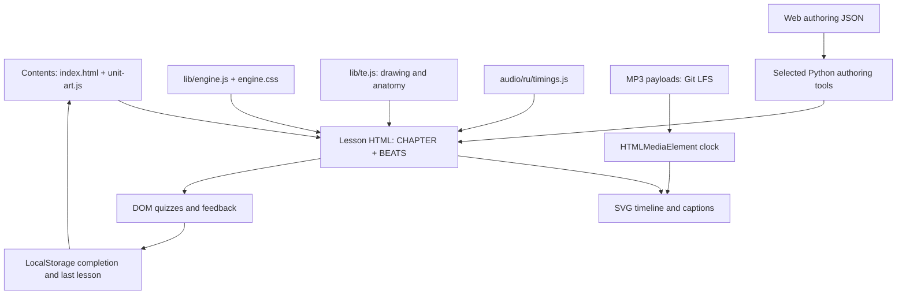

# Interactive application architecture

## Runtime boundary

Only files under `site/` are needed by the browser. Python's standard library server serves that directory. `content/` and `authoring/` support maintenance and are not runtime services. No PDF, OCR package, translator backend, source book page, translation configuration or remote inference endpoint is needed for playback.

## Files and contracts

| Component | Responsibility |
|---|---|
| `index.html` | Cover, 26-unit contents, lesson links, local progress summary |
| `unit-art.js` | Procedural artwork for contents headings |
| `lib/engine.js` | DOM/SVG stage, timeline, quiz builders, player and storage |
| `lib/engine.css` | Stage, controls, cards, responsive rules and selected reduced-motion rules |
| `lib/te.js` | Therapeutic-exercise drawing helpers and anatomy layers |
| `chNNN/index.html` | Per-lesson metadata, drawing functions, `BEATS` and quiz configuration |
| `chNNN/audio/ru/timings.js` | Beat IDs, durations, word marks and caption cues |
| `chNNN/audio/ru/*.mp3` | Narration payloads; pointers alone cannot be played |
| `atlas/`, `review/`, `glossary/`, `sandbox/` | Existing supplemental browser interfaces and their built data |
| `lib/moment.js` | Reuses lesson moments in supplementary interfaces |

The player constructs the MP3 URL from the language and beat ID. Starting a beat builds its scene and question overlay. Seeking replays earlier drawing steps to reconstruct the scene. While a clip plays, `currentTime` drives the picture; after audio failure the wall clock advances and a visible audio warning appears.

Progress keys contain the website pathname. A different host, port or deployment path creates a different storage origin/key context. There is no authentication, backend database or device synchronization.

## Authoring and testing

`authoring/therapeutic-exercise/chapters.md` supplies the lesson map consumed by the copied `register.py` and `atlas.py`; those two copies have path-only adaptations. The original authoring sources remain untouched. `register.py` rewrites navigation and must be run only deliberately in this independent copy. The candidate does not regenerate all lessons.

`cards.py`, `bio.py`, `lupa.py`, `sandbox.py` and `atlas.py` are optional web authoring utilities. `e2e_player.py`, `check_syntax.py` and `atlas_test.py` are web checks. `serve.py` is runtime tooling; `open_lesson.py` is a convenience launcher. The server's candidate copy binds to `127.0.0.1`.

Excluded: `localize_ru.py` includes a PDF-export entry point; `review.py scan` reads a translation glossary and protected book pages; `tts_retry.py` imports external Papermorph TTS code. Built review/glossary browser interfaces remain available without those tools. The placeholder audio and estimated-timing generators are not reproducibility tools and are not included.

## Deployment

Preserve the directory structure and relative asset URLs. Serve real MP3 payloads using a host that supports byte ranges. For a public deployment, first clear material-specific rights and hydrate LFS into a static artifact; separately test content type, partial responses, seeking and mobile rendering at the real URL. Local browser success is not hosted-audio proof.

The player initializes missing `d` state and normalized stroke attributes when `draw()` is called on an uninitialized path before scheduling the stroke animation.

Optional atlas authoring/checks also require Pillow; install `requirements-authoring.txt` in the separate environment. Use Python `-X utf8` for the existing player test on Windows consoles.
